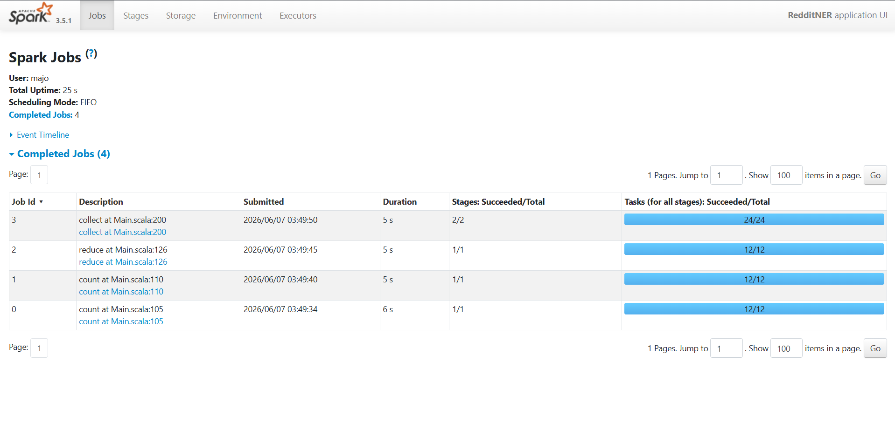
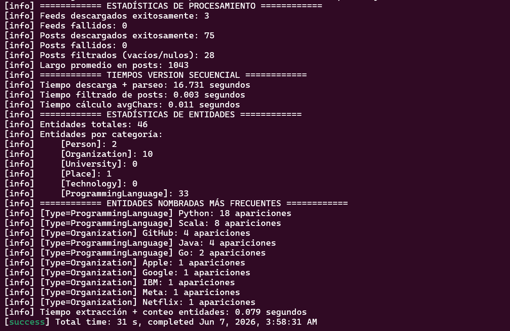

# INFORME — Laboratorio 3: Procesamiento distribuido con Apache Spark

**Materia:** Paradigmas de Programación 2026 — FAMAF  
**Laboratorio:** Lab 3 — Reddit NER con Apache Spark
**Grupo:** Nº 7
**Integrantes**:
* Aranda, María Jose
* Pinilla, Lautaro
* Sabino, Lucas
* Sosa, Santiago

---

## Índice
1. [Ejercicio 1](#ejercicio-1--identificar-las-regiones-paralelizables)
2. [Ejercicio 2](#ejercicio-2--paralelizar-la-descarga-de-feeds)
3. [Ejercicio 3](#ejercicio-3--paralelizar-el-cómputo-de-entidades-nombradas)
2. [Ejercicio 4](#ejercicio-4--monitoreo-del-éxito-de-las-tareas)
3. [Ejercicio 5](#ejercicio-5--acceso-a-datos-y-estadísticas-del-resultado)

---

## Ejercicio 1 — Identificar las regiones paralelizables

### a) Diagrama de flujo del pipeline
Estos son los pasos del pipeline, indicando el tipo de entrada y salida, y si se ejecuta en el **driver** o en los **workers**:
```
[Driver] Leer suscripciones
         FileIO.readSubscriptions(filePath)
         │
         │  List[Subscription]
         ▼
[Driver] sc.parallelize(subscriptions)
         │
         │  RDD[Subscription]
         ▼
[Worker] flatMap: descargar feed + parsear posts
         downloadFeed(url) → parsePosts(content)
         Cada worker recibe un subconjunto de suscripciones,
         descarga su feed y emite 0..N posts por suscripción.
         ← .cache() aplicado aquí →
         │
         │  RDD[Post]
         ▼
[Worker] filter: descartar posts vacíos
         title y selftext no vacíos ni blancos
         ← .cache() aplicado aquí →
         │
         │  RDD[Post]
         ▼
[Acción/Barrera] count() sobre postsRDD y filteredPostsRDD
         + lectura de acumuladores (feedsSuccess, feedsFailed,
           postsSuccess, postsFiltered)
         │
         │  Long (escalares al driver)
         ▼
[Worker] map + reduce: calcular promedio de caracteres
         post → (title.length + selftext.length), luego reduce(_ + _)
         │
         │  Long (escalar al driver)
         ▼
[Driver] Cargar diccionario
         Dictionary.loadAll(entitiesDir)
         El resultado es serializado por Spark y enviado a cada worker.
         │
         │  List[NamedEntity]  (broadcast implícito en el cierre del flatMap)
         ▼
[Worker] flatMap: extraer entidades nombradas
         Analyzer.detectEntities(text, dictionary)
         Cada post puede generar 0..N entidades.
         │
         │  RDD[NamedEntity]
         ▼
[Worker] map: entidad → par clave-valor
         entity → ((entity.entityType, entity.text), 1)
         │
         │  RDD[((String, String), Int)]
         ▼
[Worker + Barrera] reduceByKey(_ + _)
         Agrega conteos por clave (tipo, nombre).
         Barrera de sincronización: ningún worker puede producir
         el resultado parcial hasta que todos hayan emitido sus pares.
         │
         │  RDD[((String, String), Int)]
         ▼
[Driver] collect()
         Trae todos los resultados al driver.
         │
         │  Array[((String, String), Int)]
         ▼
[Driver] sortBy + take(topK) + Formatters.formatEntityStats
         Ordena, recorta al top-K e imprime.
```

Para tener en cuenta: `Dictionary.loadAll(entitiesDir)` devuelve un `List[NamedEntity]` y se ejecuta en el **driver** antes de que comience el pipeline distribuido. Ese valor se serializa y se envía a cada worker cuando se ejecuta el `flatMap` de extracción de entidades.

---

### b) Clasificación de cada paso según la abstracción de Spark

| Paso | ¿Transformación sobre RDD? | Abstracción Spark | Justificación |
|------|----------------------------|-------------------|----------------|
| 1 | Operación local | **Ninguna** | Operación local sobre un archivo. El resultado se pasa luego a `sc.parallelize` |
| 2 | Operación local | **Ninguna** | `flatten` local |
| 3 | Creación del RDD | **Ninguna** | `parallelize` no es transformación, sino el punto de entrada al grafo distribuido. Distribuye los elementos del `List[Subscription]` entre los workers |
| 4 | Sí (0..N posts) | `flatMap` | Cada `Subscription` produce cero o más `Post` (puede fallar la descarga → 0 posts, o devolver N posts) |
| 5 | Sí (0 o 1 post) | **Ninguna** | Es `filter`, no está en la lista (aunque es un caso especial de `flatMap`) |
| 6 | Operación local | **Ninguna** | Carga de diccionario en driver |
| 7 | Sí (0..N entidades) | `flatMap` | Cada `Post` produce cero o más `NamedEntity` |
| 8 | Sí (1 a 1) | `map` | Cada `NamedEntity` produce exactamente un par `((String, String), Int)`. Relación 1-a-1, sin dependencia entre elementos |
| 9 | Sí (agrupa y suma) | `reduceByKey` | Conteo global por clave, depende de todos los posts de todos los workers |
| 10 | No es transformación (acción) | **Ninguna** | `collect` es una acción, no transformación |
| 11 | Operación local | **Ninguna** | Ordenamiento e impresión en driver |

**¿Hay algún paso que no encaje en ninguna de estas abstracciones?**  
Si, los pasos 1, 2, 3, 5, 6, 10 y 11:
* Los pasos 1, 2, 3 y 6 por ser operaciones locales del driver
* El paso 5 porque es `filter` (Spark lo tiene, pero no es `map`/`flatMap`/`reduceByKey`)
* El paso 10 porque es una acción
* El paso 11 porque es ordenamiento local

---

### c) Barreras de sincronización vs. pasos independientes

**Pasos que son barreras de sincronización:**

- **`reduceByKey`**: es la única barrera del pipeline. Para calcular el conteo total de, por ejemplo, la entidad `("ProgrammingLanguage", "Scala")`, Spark necesita combinar los conteos parciales de *todos* los workers. Ningún worker puede producir el resultado final hasta que todos hayan terminado de procesar sus particiones y hayan enviado sus resultados parciales al shuffle. El resultado del `reduceByKey` no está disponible hasta que la etapa completa termina.

- **`collect()` / `take()`**: técnicamente no son barreras de transformación, pero sí son **acciones terminales** que fuerzan la ejecución completa del grafo (DAG) hasta ese punto. Todo el pipeline lazy se materializa en este momento.

**Pasos que pueden ejecutarse de forma completamente independiente entre workers:**

- `flatMap` de descarga de feeds: cada worker descarga su propio subconjunto de URLs sin coordinarse con otros. Un worker que descarga `r/scala` no necesita esperar al que descarga `r/programming`.

- `filter` de posts vacíos: la decisión de descartar un post depende únicamente de ese post, no de los demás.

- `flatMap` de extracción de entidades: cada worker procesa sus posts de forma local. La detección de `"Scala"` en un post no depende de ningún otro post.

- `map` de clasificación: transformación 1-a-1, completamente independiente entre elementos.

---

### d) Restricciones que impone Spark sobre las funciones del desarrollador

Las funciones que se pasan a las transformaciones de Spark (`map`, `flatMap`, `reduceByKey`, etc.) deben cumplir tres restricciones fundamentales para funcionar correctamente en un entorno distribuido:

**1. Serializable**

La función (closure) se serializa con Java serialization y se envía por red a cada worker. Cualquier objeto capturado en el closure debe ser `Serializable`. Si la función captura una referencia a un objeto no serializable (por ejemplo, una conexión a base de datos, un `SparkContext`, o una instancia de una clase que no implementa `Serializable`), Spark lanzará una `NotSerializableException` en tiempo de ejecución.

En este proyecto: el `Dictionary` cargado en el driver se captura en el closure del `flatMap` de extracción de entidades. La `List[NamedEntity]` es serializable (son case classes / clases simples), por lo que no hay problema. Sin embargo, si se capturara el objeto `Dictionary` como un singleton con estado, podría ser problemático.

**2. Sin estado compartido mutable**

Spark ejecuta las funciones en múltiples JVMs distintas (los workers). No existe memoria compartida entre ellas. Cualquier variable mutable definida fuera del closure y usada dentro de él **no se comparte**: cada worker tiene su propia copia serializada. Intentar usar una variable compartida (como un contador `var total = 0` modificado dentro de un `map`) producirá resultados incorrectos silenciosamente, porque las modificaciones ocurren en copias locales que nunca se propagan al driver.

La solución correcta para contadores es usar **Accumulators** (Ejercicio 4), que son el único mecanismo seguro de comunicación worker → driver.

**3. Sin efectos secundarios observables (idealmente)**

Las funciones deben ser lo más puras posible. Spark puede re-ejecutar tareas en caso de fallo (tolerancia a fallos), lo que significa que una función puede ejecutarse más de una vez sobre los mismos datos. Si la función tiene efectos secundarios como escribir a disco, enviar requests HTTP o modificar una base de datos, esas operaciones se repetirían, causando duplicados o inconsistencias.

En este proyecto: `FileIO.downloadFeed()` dentro del `flatMap` es un efecto secundario (request HTTP). Esto es aceptable y esperado para este caso de uso, pero hay que ser consciente de que ante un fallo y re-ejecución, el feed se descargaría dos veces.

**Resumen:**

| Restricción | Consecuencia si se viola |
|-------------|--------------------------|
| No serializable | `NotSerializableException` en runtime |
| Estado compartido mutable | Resultados incorrectos silenciosos |
| Efectos secundarios | Operaciones duplicadas ante re-ejecución |

---

# Preguntas y respuestas
## Ejercicio 2 — Paralelizar la descarga de feeds
### readSubscriptions
Se nos pide manejar estos casos de error:
* Si el archivo no existe -> `Error: Could not load $filePath - file not found`
* Si el JSON es invalido -> `Error: Could not load $filePath - invalid JSON format`
* Si una suscripcion le falta name o url -> `Warning: Skipping malformed subscription (missing 'name' or 'url' field)`

*Los dos primeros son errores fatales => el programa termina*  
*La ultima es warning => se interrumpe la ejecucion sin terminar*

### downloadFeed
* Tenemos que agregar el argumento `subscriptionName: String` para poder hacer un warning relacionado a esta funcion

### main
* Si no hay suscripciones válidas -> `Error: No valid subscriptions found`
* Si no se puede hacer fetch de una url -> `"Warning: Failed to download from '${subscription.name}' (${subscription.url})" (aca es donde sucede)`
* No llamamos a filterEmptyPosts ya que ahora tenemos un RDD y no se puede (deberiamos cambiar la implementacion para eso)
* Tenemos solo 3 estadisticas: **totalPosts, filteredCount, removedCount**. Las que faltan son parte del ejercicio 4
* Se adapto el formateo

### CommandLineArgs
* Indicamos que lea el archivo del mock `local_subcriptions.json`

### NamedEntity
* Hicimos que la clase `NamedEntity` extienda a `Serializable`, para que funcione con Spark

**Nota**: Los errores que aparecen al ejecutar son normales de spark

### ¿qué pasaría si dejaran propagar la excepción?
Si la excepción escapara del `flatMap`, el worker que estaba procesando esa partición fallaría. Spark tiene tolerancia a fallos e intentaría re-ejecutar esa tarea automáticamente (hasta 4 veces por defecto). Si todos los reintentos fallan, Spark cancela el job completo y el driver recibe una excepción, abortando el procesamiento de todas las suscripciones restantes, incluso las que habrían tenido éxito. Al capturar la excepción dentro del `flatMap` y devolver `List.empty[Post]`, en cambio, el fallo queda aislado a esa suscripción y el pipeline continúa con las demás.

## Ejercicio 3 — Paralelizar el cómputo de entidades nombradas
### ¿Qué ocurre en el cluster en ese punto? ¿Por qué es inevitable para este problema?
Cuando spark ejecuta reduceByKey ocurre un shuffle: cada worker envia sus pares clave-valor a otros workers segun la clave, provocando que todos los pares con la misma clave queden en el mismo worker. Recien ahi se puede sumar los conteos parciales para obtener el total global.  
Es un problema inevitable ya que para saber cuantas veces aparece una entidad, como lo podria ser `("ProgrammingLanguage", "Python")` en todos los posts es necesario combinar los resultados de todos los workers, no se puede calcular de manera local completamente.

### ¿Qué restricciones debe cumplir la función que se le pasa a reduceByKey?
La funcion debe ser conmutativa y asociativa:  
**Asociativa**: `f(f(a, b), c) == f(a, f(b, c))`. Si no lo fuera, las combinaciones darian resultados distintos.  
**Conmutativa**: `f(a, b) == f(b, a)`. Si no lo fuera, el resultado dependeria del orden de llegada.

La funcion `_ + _` *(suma entera)* cumple ambas propiedades, por eso es correcta para el conteo.

## ¿Dónde se hace la lectura del diccionario de entidades? ¿En el driver o los workers?

La lectura se hace en el **driver**, con `Dictionary.loadAll(cmdArgs.entitiesDir)` antes de que comience el pipeline distribuido de NER. El resultado, una `List[NamedEntity]`, queda capturado en el closure de la función que se le pasa al `flatMap`. Cuando Spark serializa esa función para enviarla a cada worker, serializa también todos los objetos que captura, incluyendo el diccionario completo. Cada worker recibe entonces su propia copia local del diccionario. Esto funciona correctamente para un diccionario pequeño, pero si el diccionario fuera muy grande, sería más eficiente usar una `Broadcast Variable` explícita `(sc.broadcast(dictionary))`, que Spark envía una sola vez por nodo en lugar de una vez por tarea.


## Ejercicio 4 — Monitoreo del éxito de las tareas

### ¿Por qué los Accumulators solo deben usarse para métricas y no para tomar decisiones lógicas dentro de las etapas distribuidas del pipeline?

Los Accumulators deben usarse solamente para métricas porque son una forma de comunicación limitada desde los workers hacia el driver. Los workers pueden incrementar el valor, pero el resultado final solo debe ser leído por el driver después de una acción terminal.

No conviene usarlos para tomar decisiones lógicas dentro del pipeline porque Spark puede ejecutar nuevamente tareas ante fallos, reintentos o recomputaciones. Si una tarea se ejecuta más de una vez, el acumulador puede incrementarse más de una vez para el mismo dato. Por lo tanto, el valor del acumulador puede ser útil para observabilidad, pero no debe determinar el resultado lógico del programa.

### ¿En qué situación un Accumulator puede dar un valor incorrecto?

Un Accumulator puede dar un valor incorrecto si una tarea se ejecuta más de una vez. Esto puede ocurrir por fallos, reintentos o recomputación del RDD. Por ejemplo, si un worker procesa una suscripción e incrementa `feedsSuccess`, pero luego Spark vuelve a ejecutar esa partición, el mismo feed puede contarse dos veces.

También puede ocurrir si se hacen varias acciones terminales sobre un RDD no persistido. Como Spark es lazy, cada acción puede volver a recorrer el linaje del RDD desde el origen. En ese caso, las operaciones con efectos secundarios, como `accumulator.add(1)`, pueden ejecutarse nuevamente.

### ¿En qué momento del pipeline está disponible el valor de un Accumulator para ser leído por el driver?

El valor de un Accumulator está disponible para el driver después de ejecutar una acción terminal, en nuestro caso `count()`, `reduce()` o `collect()`. Recién después de estas acciones los workers ejecutan las transformaciones y actualizan los acumuladores.

Antes de una acción terminal, las transformaciones como `map`, `flatMap` o `filter` solo construyen el plan de ejecución, pero todavía no procesan los datos.

### Spark UI



En la Spark UI se observan los jobs generados por las acciones terminales del pipeline. En esta ejecución aparecen jobs asociados a `count()`, `reduce()` y `collect()`. La UI también permite observar la duración de cada job, la cantidad de stages y la cantidad de tareas ejecutadas. En esta ejecución los jobs finalizaron correctamente.

### Captura de la ejecución secuencial



### Comparación de tiempos entre versión no paralelizada y versión con Spark

La comparación se realizó usando el mismo mock local de Reddit, el mismo archivo `valid_subscriptions.json`, el mismo directorio de entidades y la misma computadora.

| Etapa | Versión secuencial | Versión Spark |
|---|---:|---:|
| Descarga + parseo / `postsRDD.count()` | 16.731 s | 5.685 s |
| Filtrado de posts / `filteredPostsRDD.count()` | 0.003 s | 5.112 s |
| Cálculo de largo promedio (`avgChars`) | 0.011 s | 5.070 s |
| Extracción + conteo de entidades / `conteosRDD.collect()` | 0.079 s | 5.486 s |

En la etapa de descarga y parseo, la versión Spark fue más rápida que la versión secuencial, ya que las suscripciones se distribuyen entre workers mediante `sc.parallelize(subscriptions)` y se procesan con `flatMap`. En cambio, en la versión secuencial los feeds se descargan uno por uno.

Sin embargo, en las etapas posteriores la versión Spark presenta tiempos mayores para este input pequeño. Esto puede explicarse por el overhead propio de Spark: creación de jobs, planificación de stages, coordinación de tareas y comunicación entre el driver y los workers. Para pocos feeds y pocos posts, ese costo fijo puede ser más alto que el beneficio de paralelizar.

Además, en el Ejercicio 4 todavía no se utiliza `cache()`. Por lo tanto, al ejecutar varias acciones terminales sobre RDDs derivados del mismo linaje, Spark puede recomputar parte del pipeline. Esto afecta tanto los tiempos como los valores de algunos acumuladores. Este comportamiento se analiza y corrige en el Ejercicio 5 mediante persistencia de RDDs.

En conclusión, con un input pequeño no se aprecia una mejora uniforme de rendimiento en Spark. La ventaja del modelo distribuido debería verse con mayor claridad al aumentar la cantidad de feeds o posts, porque las descargas, el parseo y la extracción de entidades pueden repartirse entre workers.

## Ejercicio 5 — Acceso a datos y estadísticas del resultado

### ¿Qué ocurriría si no llamaran a cache()? ¿Cuántas veces se ejecutaría la descarga de feeds?

Si no se llamara a cache() Spark volvería a ejecutar y calcular el RDD desde subscriptionRDD para cada acción que lo necesite, es decir se ejecutaría 4 veces la descarga de feeds ya que hay 4 acciones: postsRDD.count(), filteredPostsRDD.count(), el reduce() usado para calcular avgChars y conteosRDD.collect().

### ¿Por qué es incorrecto llamar a collect() entre los pasos a) y b) del ejercicio 3 y luego continuar el pipeline? ¿Qué consecuencia tiene sobre la distribución del trabajo?

Es incorrecto llamar a collect() entre los pasos a) y b) del ejercicio 3 porque sería ineficiente, ya que collect es una acción que haría que se ejecute todo el pipeline y continúe la ejecución en el driver, por lo tanto al ejecutar map en el b) perderíamos la paralelización de los workers. Además que luego podríamos tener que volver a paralelizar lo que lo haría mas ineficiente.

### cache() es también lazy. ¿En qué momento se almacena realmente el RDD en memoria?

El RDD se guarda en memoria la primera vez que es calculado por una acción, postsRDD y filteredPostsRDD son los datos que guardamos en la cache cuando se ejecutan las acciones postsRDD.count() y filteredPostsRDD.count() respectivamente.
